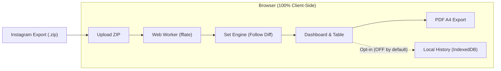

# IG Follow Analyzer

<p align="center">
  
</p>

<p align="center"><strong>100% client-side Instagram follower relationship analyzer.</strong></p>

<p align="center">
  See who doesn’t follow you back, spot recent unfollowers with opt-in local history, and export A4 PDF reports (Thai & English) directly from your own Instagram <code>.zip</code> export—no website login and no Instagram password required.
</p>

<p align="center">
  <a href="https://follow-analyzer.tawandev.site/">Open Live App</a> ·
  <a href="docs/README.en.md">Feature Docs</a> ·
  <a href="CHANGELOG.md">Changelog</a>
</p>

<p align="center"><a href="README.md">ภาษาไทย</a> · <strong>English</strong></p>

---

## Features

- **100% Browser-Local ZIP Analysis:** Extracts and analyzes Instagram `.zip` archives (JSON and HTML) inside a Web Worker without uploading follower data to any server.
- **Step-by-Step Export Guide:** Visual walkthrough for requesting your data on mobile and desktop, with a separate comparison explaining why analysis uses a ZIP.
- **Dashboard & Account Table:** Summarizes Followers, Following, Mutuals, Not Following Back, and Not Followed Back with interactive charts, search, filters, sorting, and pagination.
- **Report Export:** Optionally download an A4 PDF (Thai or English) to read or print later. Create a comparison report when account lists are available for both exports.
- **Opt-In Local History:** Automatically compare the latest ZIP with the preceding export, or choose an older export for the same account. See new and missing followers plus account timelines. History stays in the browser (`IndexedDB`), is off by default, and can be cleared after confirmation.
- **Sample Mode:** Preview a single ZIP or compare two fictitious exports, with a choice of earlier sample ZIPs before uploading your own file.
- **Bilingual & Themed UI:** Supports Thai and English, plus System (default), Dark, and Light themes.
- **Feedback and Reviews:** Report issues, suggest features, or leave a rating from the About page. When you submit a review, Google Apps Script receives the review data for storage in Google Forms and management in Google Sheets.

> Out of scope by design: website sign-up/login, Instagram OAuth, user accounts, and automated follow/unfollow actions.

## How It Works



## Tech Stack

- **Frontend:** `Vite`, `React 19`, `TypeScript`, `Tailwind CSS v4`, `lucide-react`
- **Client-Side Processing:** `fflate` (Web Worker), `pdfmake` (A4 PDF), `idb` (`IndexedDB`)
- **Quality & Testing:** `Vitest`, Testing Library, `ESLint`, `Prettier`

## Getting Started

### Requirements

- Node.js (CI uses Node.js 24) and `npm`

### Installation

```bash
npm install
```

### Run

```bash
npm run dev
```

## Usage

1. Follow the built-in guide to request your follower data in Instagram Accounts Center. Check **Current activity** to download it when it’s ready.
2. Drag and drop or select the original `.zip` file on the Analyze ZIP page, or open the interactive sample dataset from the home page.
3. Inspect the relationship breakdown, search or filter accounts, and download your A4 PDF report directly to your device (or save it to Files/Drive via your device's native save sheet).

## Development

Run code quality checks and production builds:

```bash
npm run lint
npm run lint:tailwind
npm run format:check
npm run typecheck
npm run deadcode
npm run test
npm run build
```

`npm run lint:tailwind` runs the Tailwind CSS IntelliSense language server from the terminal, including PowerShell on Windows. It reports file and line numbers for Tailwind warnings and exits with a failure when it finds any.

GitHub Actions ([`ci.yml`](.github/workflows/ci.yml)) runs these checks on every push and PR to `main`. For production hosting on **Cloudflare Pages**, set the build command to `npm run build` and the output directory to `dist`.

See the [owner's guide to enabling and managing reviews](docs/features/i18n-themes-and-privacy.en.md#collecting-reviews-through-google-forms).

## Documentation

- [Feature Documentation](docs/README.en.md) (`docs/features/`)
- [Screenshots by page and state](docs/screenshots/README.md) (desktop and mobile)
- [Changelog](CHANGELOG.md)
- [Project Agent Instructions](AGENTS.md)

## License & Notice

- Created by [Wattanaroj Butdee (GitHub)](https://github.com/Wattanaroj2567).
- `© 2026 IG Follow Analyzer` — Independent tool, not affiliated with Instagram or Meta.
- The A4 preview and exported PDF follow the active website theme and use `Plus Jakarta Sans` and `IBM Plex Sans Thai` from `public/fonts/`.
