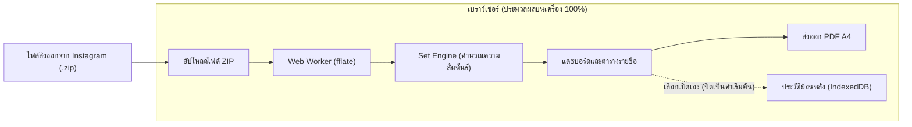

# IG Follow Analyzer

<p align="center">
  
</p>

<p align="center"><strong>วิเคราะห์ความสัมพันธ์ผู้ติดตาม Instagram แบบประมวลผลบนเครื่อง 100%</strong></p>

<p align="center">
  ตรวจสอบว่าใครไม่ติดตามกลับ เทียบคนเพิ่งเลิกติดตามจากประวัติบนเครื่อง และส่งออกรายงาน PDF A4 (ไทย / อังกฤษ) ได้ทันทีจากไฟล์ <code>.zip</code> ที่คุณส่งออกเอง โดยไม่ต้องเข้าสู่ระบบและไม่ต้องกรอกรหัสผ่าน Instagram
</p>

<p align="center">
  <a href="https://ig-follow-analyzer.pages.dev/">เปิดใช้งานเว็บ</a> ·
  <a href="docs/README.md">เอกสารฟีเจอร์</a> ·
  <a href="CHANGELOG.md">Changelog</a>
</p>

<p align="center"><strong>ภาษาไทย</strong> · <a href="README.en.md">English</a></p>

---

## ฟีเจอร์หลัก

- **ประมวลผลในเบราว์เซอร์ 100%:** อ่านและคำนวณไฟล์ `.zip` (JSON และ HTML) ใน Web Worker โดยไม่อัปโหลดข้อมูลผู้ติดตามไปยังเซิร์ฟเวอร์
- **คู่มือขอไฟล์จาก Instagram:** ขั้นตอนพร้อมภาพจำลองสำหรับทั้งมือถือและคอมพิวเตอร์
- **แดชบอร์ดและตารางรายชื่อ:** สรุปยอดผู้ติดตาม กำลังติดตาม ติดตามกันและกัน และบัญชีที่ไม่ติดตามกลับ พร้อมกราฟ ค้นหา กรอง เรียงลำดับ และแบ่งหน้า
- **ส่งออกรายงาน:** ดูตัวอย่างรายงานพอดีกับความกว้างหน้าจอและดาวน์โหลด PDF A4 (ไทย / อังกฤษ) ลงเครื่อง
- **ประวัติย้อนหลังบนเครื่อง:** เทียบไฟล์สองรอบเพื่อดูผู้ติดตามใหม่และบัญชีที่หายจากรายชื่อ พร้อมไทม์ไลน์รายบัญชี ประวัติอยู่ในเบราว์เซอร์ (`IndexedDB`) ปิดเป็นค่าเริ่มต้น และล้างข้อมูลได้หลังยืนยัน
- **โหมดตัวอย่าง:** ลองแดชบอร์ด เปิดประวัติ และย้อนดูผลจากไฟล์ ZIP สมมติแต่ละรอบได้ก่อนอัปโหลดไฟล์จริง
- **ภาษาและธีม:** รองรับภาษาไทย/อังกฤษ และธีมตามระบบ (ค่าเริ่มต้น) มืด หรือสว่าง

> ไม่รองรับการเข้าสู่ระบบเว็บไซต์, Instagram OAuth, การจัดการบัญชีผู้ใช้ หรือการติดตาม/เลิกติดตามบัญชีโดยอัตโนมัติ

## แผนผังการทำงาน



## Tech Stack

- **Frontend:** `Vite`, `React 19`, `TypeScript`, `Tailwind CSS v4`, `lucide-react`
- **Client-Side Processing:** `fflate` (Web Worker), `pdfmake` (ฟอนต์ไทย `TH Sarabun New`), `idb` (`IndexedDB`)
- **Quality & Testing:** `Vitest`, Testing Library, `ESLint`, `Prettier`

## เริ่มต้นใช้งาน

### ความต้องการของระบบ

- Node.js (CI ใช้ Node.js 24) และ `npm`

### การติดตั้ง

```bash
npm install
```

### การรันใช้งาน

```bash
npm run dev
```

## วิธีใช้งาน

1. ขอไฟล์ข้อมูลผู้ติดตาม (`.zip`) จากศูนย์บัญชี Instagram โดยดูขั้นตอนได้จากหน้าคู่มือในแอป
2. ลากหรือเลือกไฟล์ `.zip` ในหน้าอัปโหลด หรือเปิดดูผลตัวอย่างจากหน้าแรก
3. ตรวจสอบผลวิเคราะห์ ค้นหาหรือกรองรายชื่อ และดาวน์โหลดรายงาน PDF A4 ลงเครื่อง (บนมือถือสามารถเลือกบันทึกเข้าแอปไฟล์หรือแอปไดรฟ์บนเครื่องได้ทันที)

## การพัฒนา

คำสั่งสำหรับตรวจสอบคุณภาพโค้ดและสร้างไฟล์ผลิต:

```bash
npm run lint
npm run format:check
npm run typecheck
npm run deadcode
npm run test
npm run build
```

การตรวจสอบคุณภาพโค้ดทำงานอัตโนมัติผ่าน GitHub Actions ([`ci.yml`](.github/workflows/ci.yml)) ทุกครั้งที่ push หรือเปิด PR เข้า `main` (`deadcode`, `lint`, `format:check`, `typecheck`, `test` และ `build`) สำหรับการเผยแพร่ Production บน **Cloudflare Pages** ใช้ build command `npm run build` และ output directory `dist`

## เอกสารเพิ่มเติม

- [เอกสารสรุปรายฟีเจอร์](docs/README.md) (`docs/features/`)
- [Changelog](CHANGELOG.md)
- [Project Agent Instructions](AGENTS.md)

## ลิขสิทธิ์และหมายเหตุ

- `© 2026 IG Follow Analyzer` — เครื่องมืออิสระ ไม่เกี่ยวข้องกับ Instagram หรือ Meta
- พรีวิวรายงาน A4 และไฟล์ PDF ใช้ฟอนต์ `TH Sarabun New` จาก `public/fonts/`
