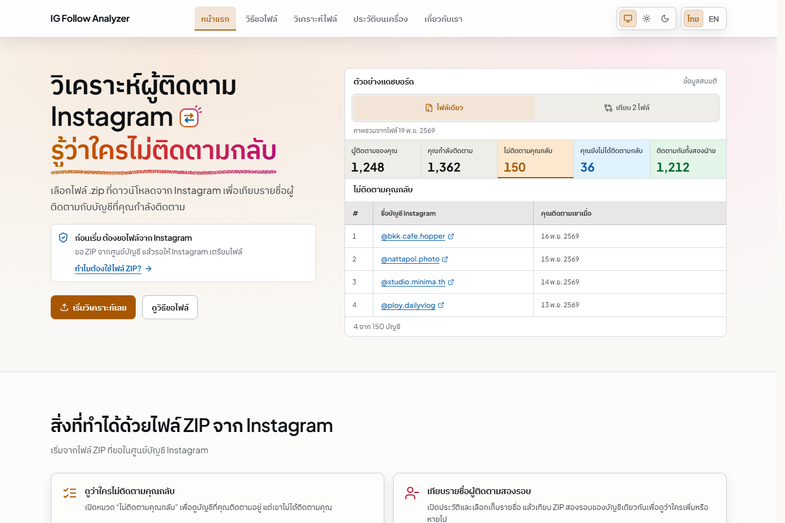
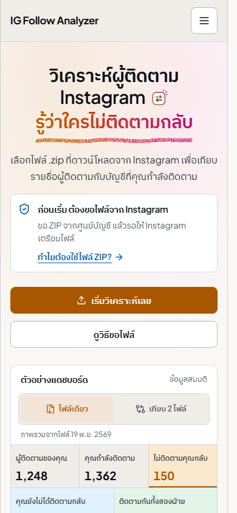

# IG Follow Analyzer Screenshots

[ภาษาไทย](README.md) · **English**

156 states · 346 images · November 28, 2026

Every state has separate desktop (**1440 × 960**) and mobile (**390 × 844**) screenshots. Select any link in the tables below to open the full-size PNG. Captures were taken in Chrome using fictitious data in a test profile. Long screens are framed around the section named in each row. The ZIP export guide also includes 34 cropped mobile illustration images.

**Simulated** means the test harness controlled the condition—for example, an unresponsive Worker, unavailable IndexedDB, or a mocked Google Forms response. These screenshots show how the UI handles those states.

| Desktop                                                                          | Mobile                                                                        |
| -------------------------------------------------------------------------------- | ----------------------------------------------------------------------------- |
|  |  |

## Home and navigation

| Page / state                                                    | Desktop                                        | Mobile                                        |
| --------------------------------------------------------------- | ---------------------------------------------- | --------------------------------------------- |
| Landing page and single-ZIP preview                             | [Open](desktop/home/landing.png)               | [Open](mobile/home/landing.png)               |
| Two-ZIP comparison preview                                      | [Open](desktop/home/landing-comparison.png)    | [Open](mobile/home/landing-comparison.png)    |
| What you can do with an Instagram ZIP                           | [Open](desktop/home/landing-use-cases.png)     | [Open](mobile/home/landing-use-cases.png)     |
| Add to Home Screen guide                                        | [Open](desktop/home/landing-install.png)       | [Open](mobile/home/landing-install.png)       |
| Homepage FAQ                                                    | [Open](desktop/home/landing-faq.png)           | [Open](mobile/home/landing-faq.png)           |
| I only have one ZIP. What can I do?                             | [Open](desktop/home/faq-01.png)                | [Open](mobile/home/faq-01.png)                |
| I saved a follower list. How do I compare it with a newer ZIP?  | [Open](desktop/home/faq-02.png)                | [Open](mobile/home/faq-02.png)                |
| What happens if I upload the same ZIP again?                    | [Open](desktop/home/faq-03.png)                | [Open](mobile/home/faq-03.png)                |
| Can the follower list change if the total stays the same?       | [Open](desktop/home/faq-04.png)                | [Open](mobile/home/faq-04.png)                |
| Why are profile pictures missing?                               | [Open](desktop/home/faq-05.png)                | [Open](mobile/home/faq-05.png)                |
| Do I need to enter my Instagram password or connect my account? | [Open](desktop/home/faq-06.png)                | [Open](mobile/home/faq-06.png)                |
| Is my followers file uploaded to a server?                      | [Open](desktop/home/faq-07.png)                | [Open](mobile/home/faq-07.png)                |
| Why do I need to request an export and wait?                    | [Open](desktop/home/faq-08.png)                | [Open](mobile/home/faq-08.png)                |
| Ratings and reviews from a test receiver · **Simulated**        | [Open](desktop/home/landing-reviews.png)       | [Open](mobile/home/landing-reviews.png)       |
| Navigation menu, language switcher, and theme switcher          | [Open](desktop/home/navigation.png)            | [Open](mobile/home/navigation.png)            |
| Dark theme and English preview                                  | [Open](desktop/home/dark-english.png)          | [Open](mobile/home/dark-english.png)          |
| Local history comparison section in Dark theme                  | [Open](desktop/home/landing-history-dark.png)  | [Open](mobile/home/landing-history-dark.png)  |
| Local history comparison section in Light theme                 | [Open](desktop/home/landing-history-light.png) | [Open](mobile/home/landing-history-light.png) |
| Closing analysis prompt in Dark theme · reviews **Simulated**   | [Open](desktop/home/landing-closing-dark.png)  | [Open](mobile/home/landing-closing-dark.png)  |
| Closing analysis prompt in Light theme · reviews **Simulated**  | [Open](desktop/home/landing-closing-light.png) | [Open](mobile/home/landing-closing-light.png) |

## ZIP export and download guide

| Page / state                                                                         | Desktop                                     | Mobile                                                                             |
| ------------------------------------------------------------------------------------ | ------------------------------------------- | ---------------------------------------------------------------------------------- |
| Instagram login vs. official ZIP comparison                                          | [Open](desktop/guide/export-comparison.png) | [Open](mobile/guide/export-comparison.png)                                         |
| Mobile ZIP export guide overview                                                     | [Open](desktop/guide/export-m.png)          | [Open](mobile/guide/export-m.png)                                                  |
| Mobile step 1 · Open your profile and tap the menu                                   | [Open](desktop/guide/m-1.png)               | [Open](mobile/guide/m-1.png) · [Illustration](mobile/guide/m-1-illustration.png)   |
| Mobile step 2 · Open Accounts Center in Settings and activity                        | [Open](desktop/guide/m-2.png)               | [Open](mobile/guide/m-2.png) · [Illustration](mobile/guide/m-2-illustration.png)   |
| Mobile step 3 · Tap Your information and permissions                                 | [Open](desktop/guide/m-3.png)               | [Open](mobile/guide/m-3.png) · [Illustration](mobile/guide/m-3-illustration.png)   |
| Mobile step 4 · Tap Export your information                                          | [Open](desktop/guide/m-4.png)               | [Open](mobile/guide/m-4.png) · [Illustration](mobile/guide/m-4-illustration.png)   |
| Mobile step 5 · Tap Create export                                                    | [Open](desktop/guide/m-5.png)               | [Open](mobile/guide/m-5.png) · [Illustration](mobile/guide/m-5-illustration.png)   |
| Mobile step 6 · Select your Instagram profile                                        | [Open](desktop/guide/m-6.png)               | [Open](mobile/guide/m-6.png) · [Illustration](mobile/guide/m-6-illustration.png)   |
| Mobile step 7 · Select Export to device                                              | [Open](desktop/guide/m-7.png)               | [Open](mobile/guide/m-7.png) · [Illustration](mobile/guide/m-7-illustration.png)   |
| Mobile step 8 · Open Customize information and check the notification email          | [Open](desktop/guide/m-8.png)               | [Open](mobile/guide/m-8.png) · [Illustration](mobile/guide/m-8-illustration.png)   |
| Mobile step 9 · Clear each category and select only Followers and following          | [Open](desktop/guide/m-9.png)               | [Open](mobile/guide/m-9.png) · [Illustration](mobile/guide/m-9-illustration.png)   |
| Mobile step 10 · Set Date range to All time and tap Save                             | [Open](desktop/guide/m-10.png)              | [Open](mobile/guide/m-10.png) · [Illustration](mobile/guide/m-10-illustration.png) |
| Mobile step 11 · Choose JSON as the format and tap Save                              | [Open](desktop/guide/m-11.png)              | [Open](mobile/guide/m-11.png) · [Illustration](mobile/guide/m-11-illustration.png) |
| Mobile step 12 · Back on the confirmation screen, tap Start export                   | [Open](desktop/guide/m-12.png)              | [Open](mobile/guide/m-12.png) · [Illustration](mobile/guide/m-12-illustration.png) |
| Mobile step 13 · Check for Request submitted, then wait for Instagram                | [Open](desktop/guide/m-13.png)              | [Open](mobile/guide/m-13.png) · [Illustration](mobile/guide/m-13-illustration.png) |
| Mobile step 14 · Return to Export your information and tap Download                  | [Open](desktop/guide/m-14.png)              | [Open](mobile/guide/m-14.png) · [Illustration](mobile/guide/m-14-illustration.png) |
| Mobile step 15 · Tap Download next to the ZIP file                                   | [Open](desktop/guide/m-15.png)              | [Open](mobile/guide/m-15.png) · [Illustration](mobile/guide/m-15-illustration.png) |
| Mobile step 16 · Confirm your password in Accounts Center                            | [Open](desktop/guide/m-16.png)              | [Open](mobile/guide/m-16.png) · [Illustration](mobile/guide/m-16-illustration.png) |
| Mobile step 17 · iPhone only — tap Open in… when the download is complete            | [Open](desktop/guide/m-17.png)              | [Open](mobile/guide/m-17.png) · [Illustration](mobile/guide/m-17-illustration.png) |
| Mobile step 18 · iPhone only — choose Save to Files                                  | [Open](desktop/guide/m-18.png)              | [Open](mobile/guide/m-18.png) · [Illustration](mobile/guide/m-18-illustration.png) |
| Mobile step 19 · Find and select your ZIP for analysis                               | [Open](desktop/guide/m-19.png)              | [Open](mobile/guide/m-19.png) · [Illustration](mobile/guide/m-19-illustration.png) |
| Desktop ZIP export guide overview                                                    | [Open](desktop/guide/export-w.png)          | [Open](mobile/guide/export-w.png)                                                  |
| Desktop step 1 · Open More and choose Settings                                       | [Open](desktop/guide/w-1.png)               | [Open](mobile/guide/w-1.png) · [Illustration](mobile/guide/w-1-illustration.png)   |
| Desktop step 2 · Open Accounts Center                                                | [Open](desktop/guide/w-2.png)               | [Open](mobile/guide/w-2.png) · [Illustration](mobile/guide/w-2-illustration.png)   |
| Desktop step 3 · Open Your information and permissions, then Export your information | [Open](desktop/guide/w-3.png)               | [Open](mobile/guide/w-3.png) · [Illustration](mobile/guide/w-3-illustration.png)   |
| Desktop step 4 · Click Create export                                                 | [Open](desktop/guide/w-4.png)               | [Open](mobile/guide/w-4.png) · [Illustration](mobile/guide/w-4-illustration.png)   |
| Desktop step 5 · Select your Instagram profile                                       | [Open](desktop/guide/w-5.png)               | [Open](mobile/guide/w-5.png) · [Illustration](mobile/guide/w-5-illustration.png)   |
| Desktop step 6 · Select Export to device                                             | [Open](desktop/guide/w-6.png)               | [Open](mobile/guide/w-6.png) · [Illustration](mobile/guide/w-6-illustration.png)   |
| Desktop step 7 · Open Customize information and check the notification email         | [Open](desktop/guide/w-7.png)               | [Open](mobile/guide/w-7.png) · [Illustration](mobile/guide/w-7-illustration.png)   |
| Desktop step 8 · Clear each category and select only Followers and following         | [Open](desktop/guide/w-8.png)               | [Open](mobile/guide/w-8.png) · [Illustration](mobile/guide/w-8-illustration.png)   |
| Desktop step 9 · Set Date range to All time and click Save                           | [Open](desktop/guide/w-9.png)               | [Open](mobile/guide/w-9.png) · [Illustration](mobile/guide/w-9-illustration.png)   |
| Desktop step 10 · Choose JSON as the format and click Save                           | [Open](desktop/guide/w-10.png)              | [Open](mobile/guide/w-10.png) · [Illustration](mobile/guide/w-10-illustration.png) |
| Desktop step 11 · Back on the confirmation screen, click Start export                | [Open](desktop/guide/w-11.png)              | [Open](mobile/guide/w-11.png) · [Illustration](mobile/guide/w-11-illustration.png) |
| Desktop step 12 · Check the status and click Download when the ZIP is ready          | [Open](desktop/guide/w-12.png)              | [Open](mobile/guide/w-12.png) · [Illustration](mobile/guide/w-12-illustration.png) |
| Desktop step 13 · Click Download next to the ZIP file                                | [Open](desktop/guide/w-13.png)              | [Open](mobile/guide/w-13.png) · [Illustration](mobile/guide/w-13-illustration.png) |
| Desktop step 14 · Confirm your password in Accounts Center                           | [Open](desktop/guide/w-14.png)              | [Open](mobile/guide/w-14.png) · [Illustration](mobile/guide/w-14-illustration.png) |
| Desktop step 15 · Find and select your ZIP for analysis                              | [Open](desktop/guide/w-15.png)              | [Open](mobile/guide/w-15.png) · [Illustration](mobile/guide/w-15-illustration.png) |

## ZIP upload, progress, and errors

| Page / state                                                | Desktop                                                      | Mobile                                                      |
| ----------------------------------------------------------- | ------------------------------------------------------------ | ----------------------------------------------------------- |
| Choose a ZIP                                                | [Open](desktop/upload/choose.png)                            | [Open](mobile/upload/choose.png)                            |
| Choose analysis mode (compare with history vs. single file) | [Open](desktop/upload/mode-selector.png)                     | [Open](mobile/upload/mode-selector.png)                     |
| Help finding your downloaded ZIP                            | [Open](desktop/upload/find-zip.png)                          | [Open](mobile/upload/find-zip.png)                          |
| Preparing and reading the file · **Simulated**              | [Open](desktop/upload/preparing.png)                         | [Open](mobile/upload/preparing.png)                         |
| Analysis cancelled · **Simulated**                          | [Open](desktop/upload/error-cancelled.png)                   | [Open](mobile/upload/error-cancelled.png)                   |
| Invalid `.zip` file extension                               | [Open](desktop/upload/error-invalid-extension.png)           | [Open](mobile/upload/error-invalid-extension.png)           |
| Multiple files selected                                     | [Open](desktop/upload/error-multiple-files.png)              | [Open](mobile/upload/error-multiple-files.png)              |
| Archive exceeds size limit · **Simulated**                  | [Open](desktop/upload/error-archive-too-large.png)           | [Open](mobile/upload/error-archive-too-large.png)           |
| Worker startup failure · **Simulated**                      | [Open](desktop/upload/error-worker-error.png)                | [Open](mobile/upload/error-worker-error.png)                |
| Failed to read file from device · **Simulated**             | [Open](desktop/upload/error-read-failed.png)                 | [Open](mobile/upload/error-read-failed.png)                 |
| Generic Worker error · **Simulated**                        | [Open](desktop/upload/error-unknown-error.png)               | [Open](mobile/upload/error-unknown-error.png)               |
| Malformed followers JSON                                    | [Open](desktop/upload/error-invalid-followers-json.png)      | [Open](mobile/upload/error-invalid-followers-json.png)      |
| Malformed following JSON                                    | [Open](desktop/upload/error-invalid-following-json.png)      | [Open](mobile/upload/error-invalid-following-json.png)      |
| Incomplete followers HTML                                   | [Open](desktop/upload/error-invalid-followers-html.png)      | [Open](mobile/upload/error-invalid-followers-html.png)      |
| Incomplete following HTML                                   | [Open](desktop/upload/error-invalid-following-html.png)      | [Open](mobile/upload/error-invalid-following-html.png)      |
| Missing numbered follower/following list parts              | [Open](desktop/upload/error-incomplete-archive-list.png)     | [Open](mobile/upload/error-incomplete-archive-list.png)     |
| Unexpected followers JSON schema                            | [Open](desktop/upload/error-unexpected-followers-schema.png) | [Open](mobile/upload/error-unexpected-followers-schema.png) |
| Unexpected following JSON schema                            | [Open](desktop/upload/error-unexpected-following-schema.png) | [Open](mobile/upload/error-unexpected-following-schema.png) |
| Empty file                                                  | [Open](desktop/upload/error-empty-file.png)                  | [Open](mobile/upload/error-empty-file.png)                  |
| File is not a ZIP archive                                   | [Open](desktop/upload/error-not-a-zip.png)                   | [Open](mobile/upload/error-not-a-zip.png)                   |
| Too many entries in ZIP · **Simulated**                     | [Open](desktop/upload/error-too-many-entries.png)            | [Open](mobile/upload/error-too-many-entries.png)            |
| Unsafe archive path rejected by Worker · **Simulated**      | [Open](desktop/upload/error-unsafe-path.png)                 | [Open](mobile/upload/error-unsafe-path.png)                 |
| Uncompressed data exceeds limit · **Simulated**             | [Open](desktop/upload/error-decompressed-too-large.png)      | [Open](mobile/upload/error-decompressed-too-large.png)      |
| Corrupt ZIP archive                                         | [Open](desktop/upload/error-corrupt-zip.png)                 | [Open](mobile/upload/error-corrupt-zip.png)                 |
| Missing both followers and following lists                  | [Open](desktop/upload/error-missing-both-sections.png)       | [Open](mobile/upload/error-missing-both-sections.png)       |
| Missing followers list                                      | [Open](desktop/upload/error-missing-followers.png)           | [Open](mobile/upload/error-missing-followers.png)           |
| Missing following list                                      | [Open](desktop/upload/error-missing-following.png)           | [Open](mobile/upload/error-missing-following.png)           |
| Extracting ZIP in Web Worker · **Simulated**                | [Open](desktop/upload/worker-progress.png)                   | [Open](mobile/upload/worker-progress.png)                   |

## Analysis results, comparisons, and account table

| Page / state                                                          | Desktop                                                        | Mobile                                                        |
| --------------------------------------------------------------------- | -------------------------------------------------------------- | ------------------------------------------------------------- |
| Opening results with no active analysis falls back to ZIP upload      | [Open](desktop/results/no-active-analysis.png)                 | [Open](mobile/results/no-active-analysis.png)                 |
| Sample results screen                                                 | [Open](desktop/results/sample.png)                             | [Open](mobile/results/sample.png)                             |
| 5-category account overview                                           | [Open](desktop/results/overview.png)                           | [Open](mobile/results/overview.png)                           |
| How percentages are calculated                                        | [Open](desktop/results/percentage-details.png)                 | [Open](mobile/results/percentage-details.png)                 |
| Table · Followers                                                     | [Open](desktop/results/table-followers.png)                    | [Open](mobile/results/table-followers.png)                    |
| Table · Following                                                     | [Open](desktop/results/table-following.png)                    | [Open](mobile/results/table-following.png)                    |
| Table · Not following you back                                        | [Open](desktop/results/table-not-following-back.png)           | [Open](mobile/results/table-not-following-back.png)           |
| Table · You don’t follow back                                         | [Open](desktop/results/table-not-followed-back.png)            | [Open](mobile/results/table-not-followed-back.png)            |
| Table · Mutual follows                                                | [Open](desktop/results/table-mutual.png)                       | [Open](mobile/results/table-mutual.png)                       |
| Empty search result                                                   | [Open](desktop/results/search-empty.png)                       | [Open](mobile/results/search-empty.png)                       |
| Choosing an earlier export to compare                                 | [Open](desktop/results/comparison-picker.png)                  | [Open](mobile/results/comparison-picker.png)                  |
| New and missing follower counts                                       | [Open](desktop/results/comparison-totals.png)                  | [Open](mobile/results/comparison-totals.png)                  |
| Inspecting the comparison ZIP’s account overview in place             | [Open](desktop/results/comparison-inspect-previous.png)        | [Open](mobile/results/comparison-inspect-previous.png)        |
| Missing followers list and timeline                                   | [Open](desktop/results/missing-timeline.png)                   | [Open](mobile/results/missing-timeline.png)                   |
| New followers list                                                    | [Open](desktop/results/new-followers.png)                      | [Open](mobile/results/new-followers.png)                      |
| First ZIP analysis with no comparison baseline                        | [Open](desktop/results/without-baseline.png)                   | [Open](mobile/results/without-baseline.png)                   |
| Real comparison between two test ZIPs                                 | [Open](desktop/results/actual-comparison.png)                  | [Open](mobile/results/actual-comparison.png)                  |
| Real comparison · Inspecting the comparison ZIP’s account overview    | [Open](desktop/results/actual-comparison-inspect-previous.png) | [Open](mobile/results/actual-comparison-inspect-previous.png) |
| Standalone single-file result while local history is enabled          | [Open](desktop/results/standalone-single-file.png)             | [Open](mobile/results/standalone-single-file.png)             |
| Warning for a 30%+ follower count drop                                | [Open](desktop/results/follower-drop.png)                      | [Open](mobile/results/follower-drop.png)                      |
| Warning for large follower turnover even when the total stays similar | [Open](desktop/results/follower-turnover.png)                  | [Open](mobile/results/follower-turnover.png)                  |
| Reopened history result after list consent is revoked in another tab  | [Open](desktop/results/history-revoked.png)                    | [Open](mobile/results/history-revoked.png)                    |

## Local history and storage consent

| Page / state                                                | Desktop                                         | Mobile                                         |
| ----------------------------------------------------------- | ----------------------------------------------- | ---------------------------------------------- |
| Sample history showing the two latest exports               | [Open](desktop/history/sample-recent.png)       | [Open](mobile/history/sample-recent.png)       |
| Full sample history with pagination                         | [Open](desktop/history/sample-all.png)          | [Open](mobile/history/sample-all.png)          |
| Local history off and empty                                 | [Open](desktop/history/off.png)                 | [Open](mobile/history/off.png)                 |
| Summary-only storage enabled                                | [Open](desktop/history/summary-only.png)        | [Open](mobile/history/summary-only.png)        |
| Both storage levels enabled before uploading a ZIP          | [Open](desktop/history/ready.png)               | [Open](mobile/history/ready.png)               |
| Saved entries from two accounts                             | [Open](desktop/history/records.png)             | [Open](mobile/history/records.png)             |
| Filtered to a single account                                | [Open](desktop/history/filtered.png)            | [Open](mobile/history/filtered.png)            |
| Expanded saved entry details                                | [Open](desktop/history/entry-details.png)       | [Open](mobile/history/entry-details.png)       |
| Confirm deleting a single entry                             | [Open](desktop/history/delete-confirmation.png) | [Open](mobile/history/delete-confirmation.png) |
| Confirm clearing all local history                          | [Open](desktop/history/clear-confirmation.png)  | [Open](mobile/history/clear-confirmation.png)  |
| State after clearing history and resetting toggles          | [Open](desktop/history/cleared.png)             | [Open](mobile/history/cleared.png)             |
| Storage error when IndexedDB is unavailable · **Simulated** | [Open](desktop/history/storage-error.png)       | [Open](mobile/history/storage-error.png)       |

## Creating and downloading PDF reports

| Page / state                                                    | Desktop                                   | Mobile                                   |
| --------------------------------------------------------------- | ----------------------------------------- | ---------------------------------------- |
| Opening PDF report with no active analysis falls back to upload | [Open](desktop/pdf/no-active-report.png)  | [Open](mobile/pdf/no-active-report.png)  |
| PDF report from two compared test ZIPs                          | [Open](desktop/pdf/actual-comparison.png) | [Open](mobile/pdf/actual-comparison.png) |
| Sample PDF report options                                       | [Open](desktop/pdf/sample.png)            | [Open](mobile/pdf/sample.png)            |
| English PDF account table page                                  | [Open](desktop/pdf/page-list-en.png)      | [Open](mobile/pdf/page-list-en.png)      |
| Fullscreen A4 preview                                           | [Open](desktop/pdf/fullscreen.png)        | [Open](mobile/pdf/fullscreen.png)        |
| Zoomed fullscreen A4 preview                                    | [Open](desktop/pdf/zoom.png)              | [Open](mobile/pdf/zoom.png)              |
| Download started confirmation                                   | [Open](desktop/pdf/downloaded.png)        | [Open](mobile/pdf/downloaded.png)        |
| All sections unchecked with download button disabled            | [Open](desktop/pdf/no-sections.png)       | [Open](mobile/pdf/no-sections.png)       |
| PDF font load error state · **Simulated**                       | [Open](desktop/pdf/error.png)             | [Open](mobile/pdf/error.png)             |
| Generating PDF while loading fonts · **Simulated**              | [Open](desktop/pdf/pdf-generating.png)    | [Open](mobile/pdf/pdf-generating.png)    |

## Privacy, FAQ, and forms

| Page / state                                                                    | Desktop                                            | Mobile                                            |
| ------------------------------------------------------------------------------- | -------------------------------------------------- | ------------------------------------------------- |
| Terms and Privacy                                                               | [Open](desktop/information/terms.png)              | [Open](mobile/information/terms.png)              |
| Full FAQ section                                                                | [Open](desktop/information/full-faq.png)           | [Open](mobile/information/full-faq.png)           |
| Do I need to enter my Instagram password, or could my account be suspended?     | [Open](desktop/information/faq-01.png)             | [Open](mobile/information/faq-01.png)             |
| Does this site use cookies or login sessions?                                   | [Open](desktop/information/faq-02.png)             | [Open](mobile/information/faq-02.png)             |
| Are my .zip file or follower lists uploaded to a server?                        | [Open](desktop/information/faq-03.png)             | [Open](mobile/information/faq-03.png)             |
| Which export settings should I choose on Instagram, and how long does it take?  | [Open](desktop/information/faq-04.png)             | [Open](mobile/information/faq-04.png)             |
| Can I upload an HTML export instead of JSON? What is the difference?            | [Open](desktop/information/faq-05.png)             | [Open](mobile/information/faq-05.png)             |
| Why does my follower count differ from my Instagram profile?                    | [Open](desktop/information/faq-06.png)             | [Open](mobile/information/faq-06.png)             |
| I only have one ZIP. What can I do?                                             | [Open](desktop/information/faq-07.png)             | [Open](mobile/information/faq-07.png)             |
| I saved a follower list. How do I compare it with a newer ZIP?                  | [Open](desktop/information/faq-08.png)             | [Open](mobile/information/faq-08.png)             |
| What happens if I upload the same ZIP again?                                    | [Open](desktop/information/faq-09.png)             | [Open](mobile/information/faq-09.png)             |
| Can the follower list change if the total stays the same?                       | [Open](desktop/information/faq-10.png)             | [Open](mobile/information/faq-10.png)             |
| Can I analyze multiple Instagram accounts on the same device?                   | [Open](desktop/information/faq-11.png)             | [Open](mobile/information/faq-11.png)             |
| Does local processing or saved history slow down my device or use much storage? | [Open](desktop/information/faq-12.png)             | [Open](mobile/information/faq-12.png)             |
| How do I open profiles or export a PDF report? Which languages are supported?   | [Open](desktop/information/faq-13.png)             | [Open](mobile/information/faq-13.png)             |
| How do I delete saved history, and what happens if I clear browser data?        | [Open](desktop/information/faq-14.png)             | [Open](mobile/information/faq-14.png)             |
| Direct link to feedback data privacy topic                                      | [Open](desktop/information/privacy-feedback.png)   | [Open](mobile/information/privacy-feedback.png)   |
| Direct link to review data privacy topic                                        | [Open](desktop/information/privacy-review.png)     | [Open](mobile/information/privacy-review.png)     |
| About IG Follow Analyzer                                                        | [Open](desktop/information/about.png)              | [Open](mobile/information/about.png)              |
| Feedback form                                                                   | [Open](desktop/information/feedback-form.png)      | [Open](mobile/information/feedback-form.png)      |
| Feedback confirmation keeping draft open · **Simulated**                        | [Open](desktop/information/feedback-submitted.png) | [Open](mobile/information/feedback-submitted.png) |
| Review form before submission                                                   | [Open](desktop/information/review-form.png)        | [Open](mobile/information/review-form.png)        |
| Submitting review · **Simulated**                                               | [Open](desktop/information/review-sending.png)     | [Open](mobile/information/review-sending.png)     |
| Review submission failed while keeping draft · **Simulated**                    | [Open](desktop/information/review-error.png)       | [Open](mobile/information/review-error.png)       |
| Simulated review submitted successfully · **Simulated**                         | [Open](desktop/information/review-success.png)     | [Open](mobile/information/review-success.png)     |
| Receiver reports duplicate rating · **Simulated**                               | [Open](desktop/information/review-duplicate.png)   | [Open](mobile/information/review-duplicate.png)   |
| Review form when intake is paused · **Simulated**                               | [Open](desktop/information/review-unavailable.png) | [Open](mobile/information/review-unavailable.png) |

[เอกสารฟีเจอร์ ภาษาไทย](../README.md) · [Feature documentation in English](../README.en.md)
