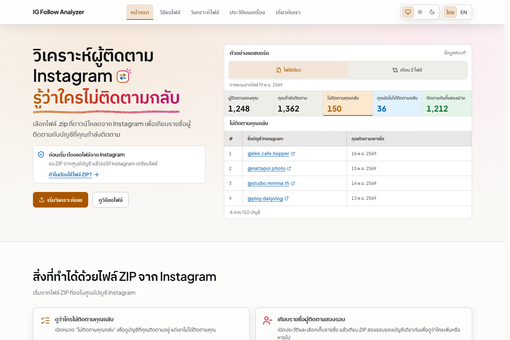
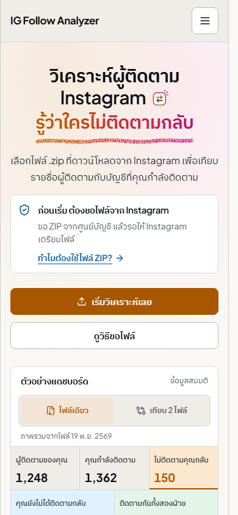

# ภาพหน้าจอ IG Follow Analyzer

**ภาษาไทย** · [English](README.en.md)

152 สถานะ · 338 ภาพ · 21 พฤศจิกายน 2026

ทุกสถานะมีภาพเดสก์ท็อป **1440 × 960** และมือถือ **390 × 844** แยกกัน กดลิงก์ในตารางเพื่อเปิด PNG ขนาดจริง ภาพใช้ Chrome และข้อมูลสมมติในโปรไฟล์ทดสอบ ภาพหน้าจอยาวจัดเฟรมตามส่วนที่ระบุในแถว คู่มือขอ ZIP มีภาพซูมไปยังส่วนภาพประกอบบนมือถือเพิ่มอีก 34 ภาพ

**จำลอง** หมายถึงโปรไฟล์ทดสอบควบคุมเหตุการณ์ เช่น Worker ไม่ตอบกลับ, IndexedDB ใช้งานไม่ได้ หรือ Google Forms ตอบรับหรือปฏิเสธ ภาพเหล่านี้แสดง UI ของแอปเมื่อเกิดสถานะดังกล่าว

| เดสก์ท็อป                                                                  | มือถือ                                                                |
| ------------------------------------------------------------------------ | ------------------------------------------------------------------- |
|  |  |

## หน้าแรกและการนำทาง

| หน้า / สถานะ                                   | เดสก์ท็อป                                          | มือถือ                                            |
| --------------------------------------------- | ------------------------------------------------ | ----------------------------------------------- |
| หน้าแรกและตัวอย่าง ZIP เดียว                      | [เปิดภาพ](desktop/home/landing.png)               | [เปิดภาพ](mobile/home/landing.png)               |
| ตัวอย่างเทียบ ZIP สองรอบ                         | [เปิดภาพ](desktop/home/landing-comparison.png)    | [เปิดภาพ](mobile/home/landing-comparison.png)    |
| สิ่งที่ทำได้ด้วยไฟล์ ZIP จาก Instagram               | [เปิดภาพ](desktop/home/landing-use-cases.png)     | [เปิดภาพ](mobile/home/landing-use-cases.png)     |
| คู่มือเพิ่มเว็บลงหน้าจอหลัก                           | [เปิดภาพ](desktop/home/landing-install.png)       | [เปิดภาพ](mobile/home/landing-install.png)       |
| คำถามที่พบบ่อยบนหน้าแรก                           | [เปิดภาพ](desktop/home/landing-faq.png)           | [เปิดภาพ](mobile/home/landing-faq.png)           |
| ใช้ครั้งแรก มี ZIP แค่ไฟล์เดียว ทำอะไรได้บ้าง?         | [เปิดภาพ](desktop/home/faq-01.png)                | [เปิดภาพ](mobile/home/faq-01.png)                |
| เคยเก็บรายชื่อไว้แล้ว จะเทียบกับ ZIP รอบใหม่ยังไง?     | [เปิดภาพ](desktop/home/faq-02.png)                | [เปิดภาพ](mobile/home/faq-02.png)                |
| ถ้าอัปโหลด ZIP เดิมซ้ำ ระบบจะทำอะไร?              | [เปิดภาพ](desktop/home/faq-03.png)                | [เปิดภาพ](mobile/home/faq-03.png)                |
| ยอดผู้ติดตามเท่าเดิม รายชื่อเปลี่ยนได้ไหม?              | [เปิดภาพ](desktop/home/faq-04.png)                | [เปิดภาพ](mobile/home/faq-04.png)                |
| ทำไมไม่แสดงรูปโปรไฟล์ของแต่ละบัญชี?                 | [เปิดภาพ](desktop/home/faq-05.png)                | [เปิดภาพ](mobile/home/faq-05.png)                |
| ต้องกรอกรหัสผ่าน Instagram หรือเชื่อมบัญชีกับเว็บนี้ไหม?  | [เปิดภาพ](desktop/home/faq-06.png)                | [เปิดภาพ](mobile/home/faq-06.png)                |
| ไฟล์ข้อมูลผู้ติดตามถูกอัปโหลดไปที่เซิร์ฟเวอร์หรือเปล่า?      | [เปิดภาพ](desktop/home/faq-07.png)                | [เปิดภาพ](mobile/home/faq-07.png)                |
| ทำไมต้องขอไฟล์เองและรอให้พร้อม?                   | [เปิดภาพ](desktop/home/faq-08.png)                | [เปิดภาพ](mobile/home/faq-08.png)                |
| คะแนนและรีวิวจากตัวรับจำลอง · **จำลอง**           | [เปิดภาพ](desktop/home/landing-reviews.png)       | [เปิดภาพ](mobile/home/landing-reviews.png)       |
| เมนูและตัวเลือกภาษาและธีม                         | [เปิดภาพ](desktop/home/navigation.png)            | [เปิดภาพ](mobile/home/navigation.png)            |
| ตัวอย่างธีมมืดและภาษาอังกฤษ                        | [เปิดภาพ](desktop/home/dark-english.png)          | [เปิดภาพ](mobile/home/dark-english.png)          |
| พื้นส่วนเทียบประวัติในธีมมืด                          | [เปิดภาพ](desktop/home/landing-history-dark.png)  | [เปิดภาพ](mobile/home/landing-history-dark.png)  |
| พื้นส่วนเทียบประวัติในธีมสว่าง                        | [เปิดภาพ](desktop/home/landing-history-light.png) | [เปิดภาพ](mobile/home/landing-history-light.png) |
| พื้นส่วนเริ่มวิเคราะห์ท้ายหน้าในธีมมืด · รีวิว **จำลอง**   | [เปิดภาพ](desktop/home/landing-closing-dark.png)  | [เปิดภาพ](mobile/home/landing-closing-dark.png)  |
| พื้นส่วนเริ่มวิเคราะห์ท้ายหน้าในธีมสว่าง · รีวิว **จำลอง** | [เปิดภาพ](desktop/home/landing-closing-light.png) | [เปิดภาพ](mobile/home/landing-closing-light.png) |

## คู่มือขอและดาวน์โหลด ZIP

| หน้า / สถานะ                                                                                          | เดสก์ท็อป                                       | มือถือ                                                                              |
| ---------------------------------------------------------------------------------------------------- | --------------------------------------------- | --------------------------------------------------------------------------------- |
| เทียบ Instagram Login และ ZIP                                                                         | [เปิดภาพ](desktop/guide/export-comparison.png) | [เปิดภาพ](mobile/guide/export-comparison.png)                                      |
| คู่มือขอ ZIP บนมือถือ                                                                                     | [เปิดภาพ](desktop/guide/export-m.png)          | [เปิดภาพ](mobile/guide/export-m.png)                                               |
| ขั้น มือถือ 1 · เปิดหน้าโปรไฟล์และแตะเมนูสามขีด                                                               | [เปิดภาพ](desktop/guide/m-1.png)               | [เปิดภาพ](mobile/guide/m-1.png) · [ภาพประกอบ](mobile/guide/m-1-illustration.png)   |
| ขั้น มือถือ 2 · เข้าเมนู การตั้งค่าและกิจกรรม แล้วแตะ ศูนย์บัญชี                                                    | [เปิดภาพ](desktop/guide/m-2.png)               | [เปิดภาพ](mobile/guide/m-2.png) · [ภาพประกอบ](mobile/guide/m-2-illustration.png)   |
| ขั้น มือถือ 3 · ในหน้า ศูนย์บัญชี เลือก ข้อมูลและสิทธิ์การอนุญาตของคุณ                                                | [เปิดภาพ](desktop/guide/m-3.png)               | [เปิดภาพ](mobile/guide/m-3.png) · [ภาพประกอบ](mobile/guide/m-3-illustration.png)   |
| ขั้น มือถือ 4 · เลือก ส่งออกข้อมูลของคุณ                                                                      | [เปิดภาพ](desktop/guide/m-4.png)               | [เปิดภาพ](mobile/guide/m-4.png) · [ภาพประกอบ](mobile/guide/m-4-illustration.png)   |
| ขั้น มือถือ 5 · แตะปุ่ม สร้างไฟล์ส่งออก                                                                       | [เปิดภาพ](desktop/guide/m-5.png)               | [เปิดภาพ](mobile/guide/m-5.png) · [ภาพประกอบ](mobile/guide/m-5-illustration.png)   |
| ขั้น มือถือ 6 · หน้า เลือกโปรไฟล์ ให้เลือกบัญชี Instagram ของคุณ                                                 | [เปิดภาพ](desktop/guide/m-6.png)               | [เปิดภาพ](mobile/guide/m-6.png) · [ภาพประกอบ](mobile/guide/m-6-illustration.png)   |
| ขั้น มือถือ 7 · หน้า เลือกปลายทางเพื่อส่งออก เลือก ส่งออกไปยังอุปกรณ์                                              | [เปิดภาพ](desktop/guide/m-7.png)               | [เปิดภาพ](mobile/guide/m-7.png) · [ภาพประกอบ](mobile/guide/m-7-illustration.png)   |
| ขั้น มือถือ 8 · หน้า ยืนยันการส่งออกของคุณ — แตะ ปรับแต่งข้อมูล (และเช็กอีเมลในช่อง แจ้ง)                             | [เปิดภาพ](desktop/guide/m-8.png)               | [เปิดภาพ](mobile/guide/m-8.png) · [ภาพประกอบ](mobile/guide/m-8-illustration.png)   |
| ขั้น มือถือ 9 · หน้า เลือกข้อมูลที่ต้องการส่งออก — เลื่อนลงกด ล้างทั้งหมด ทุกหมวด แล้วติ๊กเฉพาะ ผู้ติดตามและคนที่คุณติดตาม       | [เปิดภาพ](desktop/guide/m-9.png)               | [เปิดภาพ](mobile/guide/m-9.png) · [ภาพประกอบ](mobile/guide/m-9-illustration.png)   |
| ขั้น มือถือ 10 · เลือกช่วงวันที่ ตั้งแต่ต้น (All time) แล้วแตะ บันทึก                                                | [เปิดภาพ](desktop/guide/m-10.png)              | [เปิดภาพ](mobile/guide/m-10.png) · [ภาพประกอบ](mobile/guide/m-10-illustration.png) |
| ขั้น มือถือ 11 · เลือกรูปแบบ JSON แล้วแตะ บันทึก                                                              | [เปิดภาพ](desktop/guide/m-11.png)              | [เปิดภาพ](mobile/guide/m-11.png) · [ภาพประกอบ](mobile/guide/m-11-illustration.png) |
| ขั้น มือถือ 12 · กลับมาหน้ายืนยัน แล้วแตะ เริ่มส่งออก                                                            | [เปิดภาพ](desktop/guide/m-12.png)              | [เปิดภาพ](mobile/guide/m-12.png) · [ภาพประกอบ](mobile/guide/m-12-illustration.png) |
| ขั้น มือถือ 13 · เช็กว่า ส่งคำขอแล้ว แล้วรอ Instagram เตรียมไฟล์                                                | [เปิดภาพ](desktop/guide/m-13.png)              | [เปิดภาพ](mobile/guide/m-13.png) · [ภาพประกอบ](mobile/guide/m-13-illustration.png) |
| ขั้น มือถือ 14 · เมื่อไฟล์พร้อม กลับเข้าแอป IG หน้า ส่งออกข้อมูลของคุณ แล้วแตะ ดาวน์โหลด                              | [เปิดภาพ](desktop/guide/m-14.png)              | [เปิดภาพ](mobile/guide/m-14.png) · [ภาพประกอบ](mobile/guide/m-14-illustration.png) |
| ขั้น มือถือ 15 · แตะดาวน์โหลดที่แถวไฟล์ ZIP                                                                  | [เปิดภาพ](desktop/guide/m-15.png)              | [เปิดภาพ](mobile/guide/m-15.png) · [ภาพประกอบ](mobile/guide/m-15-illustration.png) |
| ขั้น มือถือ 16 · ยืนยันรหัสผ่านในศูนย์บัญชี                                                                      | [เปิดภาพ](desktop/guide/m-16.png)              | [เปิดภาพ](mobile/guide/m-16.png) · [ภาพประกอบ](mobile/guide/m-16-illustration.png) |
| ขั้น มือถือ 17 · สำหรับ iPhone เท่านั้น — แตะ เปิดใน… เมื่อดาวน์โหลดเสร็จ                                         | [เปิดภาพ](desktop/guide/m-17.png)              | [เปิดภาพ](mobile/guide/m-17.png) · [ภาพประกอบ](mobile/guide/m-17-illustration.png) |
| ขั้น มือถือ 18 · สำหรับ iPhone เท่านั้น — เลือก บันทึกไปยัง แอปไฟล์                                               | [เปิดภาพ](desktop/guide/m-18.png)              | [เปิดภาพ](mobile/guide/m-18.png) · [ภาพประกอบ](mobile/guide/m-18-illustration.png) |
| ขั้น มือถือ 19 · หาไฟล์ ZIP แล้วเลือกไฟล์เพื่อวิเคราะห์                                                          | [เปิดภาพ](desktop/guide/m-19.png)              | [เปิดภาพ](mobile/guide/m-19.png) · [ภาพประกอบ](mobile/guide/m-19-illustration.png) |
| คู่มือขอ ZIP บนคอมพิวเตอร์                                                                                | [เปิดภาพ](desktop/guide/export-w.png)          | [เปิดภาพ](mobile/guide/export-w.png)                                               |
| ขั้น คอมพิวเตอร์ 1 · เปิด เพิ่มเติม แล้วเลือก การตั้งค่า                                                          | [เปิดภาพ](desktop/guide/w-1.png)               | [เปิดภาพ](mobile/guide/w-1.png) · [ภาพประกอบ](mobile/guide/w-1-illustration.png)   |
| ขั้น คอมพิวเตอร์ 2 · หน้า การตั้งค่า คลิก ศูนย์บัญชี ด้านซ้ายบน                                                     | [เปิดภาพ](desktop/guide/w-2.png)               | [เปิดภาพ](mobile/guide/w-2.png) · [ภาพประกอบ](mobile/guide/w-2-illustration.png)   |
| ขั้น คอมพิวเตอร์ 3 · เลือก ข้อมูลและสิทธิ์การอนุญาตของคุณ และ ส่งออกข้อมูลของคุณ                                     | [เปิดภาพ](desktop/guide/w-3.png)               | [เปิดภาพ](mobile/guide/w-3.png) · [ภาพประกอบ](mobile/guide/w-3-illustration.png)   |
| ขั้น คอมพิวเตอร์ 4 · หน้า ส่งออกข้อมูลของคุณ คลิกปุ่ม สร้างไฟล์ส่งออก                                               | [เปิดภาพ](desktop/guide/w-4.png)               | [เปิดภาพ](mobile/guide/w-4.png) · [ภาพประกอบ](mobile/guide/w-4-illustration.png)   |
| ขั้น คอมพิวเตอร์ 5 · หน้า เลือกโปรไฟล์ คลิกเลือกบัญชี Instagram ของคุณ                                           | [เปิดภาพ](desktop/guide/w-5.png)               | [เปิดภาพ](mobile/guide/w-5.png) · [ภาพประกอบ](mobile/guide/w-5-illustration.png)   |
| ขั้น คอมพิวเตอร์ 6 · หน้า เลือกปลายทางเพื่อส่งออก เลือก ส่งออกไปยังอุปกรณ์                                         | [เปิดภาพ](desktop/guide/w-6.png)               | [เปิดภาพ](mobile/guide/w-6.png) · [ภาพประกอบ](mobile/guide/w-6-illustration.png)   |
| ขั้น คอมพิวเตอร์ 7 · หน้า ยืนยันการส่งออกของคุณ — คลิก ปรับแต่งข้อมูล (และเช็กอีเมลในช่อง แจ้ง)                        | [เปิดภาพ](desktop/guide/w-7.png)               | [เปิดภาพ](mobile/guide/w-7.png) · [ภาพประกอบ](mobile/guide/w-7-illustration.png)   |
| ขั้น คอมพิวเตอร์ 8 · หน้า เลือกข้อมูลที่ต้องการส่งออก — เลื่อนลงคลิก ล้างทั้งหมด ทุกหมวด แล้วติ๊กเฉพาะ ผู้ติดตามและคนที่คุณติดตาม | [เปิดภาพ](desktop/guide/w-8.png)               | [เปิดภาพ](mobile/guide/w-8.png) · [ภาพประกอบ](mobile/guide/w-8-illustration.png)   |
| ขั้น คอมพิวเตอร์ 9 · คลิก ช่วงวันที่ — เปลี่ยนจาก ปีที่แล้ว เป็น ตลอดเวลา (All time) แล้วคลิก บันทึก                     | [เปิดภาพ](desktop/guide/w-9.png)               | [เปิดภาพ](mobile/guide/w-9.png) · [ภาพประกอบ](mobile/guide/w-9-illustration.png)   |
| ขั้น คอมพิวเตอร์ 10 · เลือกรูปแบบ JSON แล้วคลิก บันทึก                                                         | [เปิดภาพ](desktop/guide/w-10.png)              | [เปิดภาพ](mobile/guide/w-10.png) · [ภาพประกอบ](mobile/guide/w-10-illustration.png) |
| ขั้น คอมพิวเตอร์ 11 · กลับมาหน้ายืนยัน แล้วคลิก เริ่มส่งออก                                                       | [เปิดภาพ](desktop/guide/w-11.png)              | [เปิดภาพ](mobile/guide/w-11.png) · [ภาพประกอบ](mobile/guide/w-11-illustration.png) |
| ขั้น คอมพิวเตอร์ 12 · เช็กสถานะ แล้วคลิก ดาวน์โหลด เมื่อไฟล์พร้อม                                                | [เปิดภาพ](desktop/guide/w-12.png)              | [เปิดภาพ](mobile/guide/w-12.png) · [ภาพประกอบ](mobile/guide/w-12-illustration.png) |
| ขั้น คอมพิวเตอร์ 13 · คลิกดาวน์โหลดที่แถวไฟล์ ZIP                                                             | [เปิดภาพ](desktop/guide/w-13.png)              | [เปิดภาพ](mobile/guide/w-13.png) · [ภาพประกอบ](mobile/guide/w-13-illustration.png) |
| ขั้น คอมพิวเตอร์ 14 · ยืนยันรหัสผ่านในศูนย์บัญชี                                                                 | [เปิดภาพ](desktop/guide/w-14.png)              | [เปิดภาพ](mobile/guide/w-14.png) · [ภาพประกอบ](mobile/guide/w-14-illustration.png) |
| ขั้น คอมพิวเตอร์ 15 · หาไฟล์ ZIP แล้วเลือกไฟล์เพื่อวิเคราะห์                                                     | [เปิดภาพ](desktop/guide/w-15.png)              | [เปิดภาพ](mobile/guide/w-15.png) · [ภาพประกอบ](mobile/guide/w-15-illustration.png) |

## เลือก ZIP ความคืบหน้า และข้อผิดพลาด

| หน้า / สถานะ                        | เดสก์ท็อป                                                        | มือถือ                                                          |
| ---------------------------------- | -------------------------------------------------------------- | ------------------------------------------------------------- |
| เลือก ZIP                           | [เปิดภาพ](desktop/upload/choose.png)                            | [เปิดภาพ](mobile/upload/choose.png)                            |
| เปิดคู่มือหา ZIP ที่ดาวน์โหลดไว้           | [เปิดภาพ](desktop/upload/find-zip.png)                          | [เปิดภาพ](mobile/upload/find-zip.png)                          |
| กำลังอ่านไฟล์ · **จำลอง**             | [เปิดภาพ](desktop/upload/preparing.png)                         | [เปิดภาพ](mobile/upload/preparing.png)                         |
| ยกเลิกการวิเคราะห์ · **จำลอง**        | [เปิดภาพ](desktop/upload/error-cancelled.png)                   | [เปิดภาพ](mobile/upload/error-cancelled.png)                   |
| นามสกุล .zip ไม่ถูกต้อง                | [เปิดภาพ](desktop/upload/error-invalid-extension.png)           | [เปิดภาพ](mobile/upload/error-invalid-extension.png)           |
| เลือกหลายไฟล์                        | [เปิดภาพ](desktop/upload/error-multiple-files.png)              | [เปิดภาพ](mobile/upload/error-multiple-files.png)              |
| ZIP เกินขนาด · **จำลอง**            | [เปิดภาพ](desktop/upload/error-archive-too-large.png)           | [เปิดภาพ](mobile/upload/error-archive-too-large.png)           |
| เปิด Worker ไม่สำเร็จ · **จำลอง**     | [เปิดภาพ](desktop/upload/error-worker-error.png)                | [เปิดภาพ](mobile/upload/error-worker-error.png)                |
| อ่านไฟล์จากอุปกรณ์ไม่สำเร็จ · **จำลอง**  | [เปิดภาพ](desktop/upload/error-read-failed.png)                 | [เปิดภาพ](mobile/upload/error-read-failed.png)                 |
| ข้อผิดพลาดทั่วไปจาก Worker · **จำลอง** | [เปิดภาพ](desktop/upload/error-unknown-error.png)               | [เปิดภาพ](mobile/upload/error-unknown-error.png)               |
| JSON ผู้ติดตามเสีย                     | [เปิดภาพ](desktop/upload/error-invalid-followers-json.png)      | [เปิดภาพ](mobile/upload/error-invalid-followers-json.png)      |
| JSON กำลังติดตามเสีย                  | [เปิดภาพ](desktop/upload/error-invalid-following-json.png)      | [เปิดภาพ](mobile/upload/error-invalid-following-json.png)      |
| HTML ผู้ติดตามไม่ครบ                   | [เปิดภาพ](desktop/upload/error-invalid-followers-html.png)      | [เปิดภาพ](mobile/upload/error-invalid-followers-html.png)      |
| HTML กำลังติดตามไม่ครบ                | [เปิดภาพ](desktop/upload/error-invalid-following-html.png)      | [เปิดภาพ](mobile/upload/error-invalid-following-html.png)      |
| หมายเลขไฟล์ย่อยขาดช่วง                | [เปิดภาพ](desktop/upload/error-incomplete-archive-list.png)     | [เปิดภาพ](mobile/upload/error-incomplete-archive-list.png)     |
| โครงสร้าง JSON ผู้ติดตามผิด             | [เปิดภาพ](desktop/upload/error-unexpected-followers-schema.png) | [เปิดภาพ](mobile/upload/error-unexpected-followers-schema.png) |
| โครงสร้าง JSON กำลังติดตามผิด          | [เปิดภาพ](desktop/upload/error-unexpected-following-schema.png) | [เปิดภาพ](mobile/upload/error-unexpected-following-schema.png) |
| ไฟล์ว่าง                             | [เปิดภาพ](desktop/upload/error-empty-file.png)                  | [เปิดภาพ](mobile/upload/error-empty-file.png)                  |
| เนื้อหาไม่ใช่ ZIP                      | [เปิดภาพ](desktop/upload/error-not-a-zip.png)                   | [เปิดภาพ](mobile/upload/error-not-a-zip.png)                   |
| ZIP มีไฟล์ย่อยมากเกินกำหนด · **จำลอง** | [เปิดภาพ](desktop/upload/error-too-many-entries.png)            | [เปิดภาพ](mobile/upload/error-too-many-entries.png)            |
| Worker ปฏิเสธเส้นทางไฟล์ · **จำลอง**  | [เปิดภาพ](desktop/upload/error-unsafe-path.png)                 | [เปิดภาพ](mobile/upload/error-unsafe-path.png)                 |
| ข้อมูลหลังแตกไฟล์เกินขนาด · **จำลอง**   | [เปิดภาพ](desktop/upload/error-decompressed-too-large.png)      | [เปิดภาพ](mobile/upload/error-decompressed-too-large.png)      |
| ZIP ไม่สมบูรณ์                        | [เปิดภาพ](desktop/upload/error-corrupt-zip.png)                 | [เปิดภาพ](mobile/upload/error-corrupt-zip.png)                 |
| ไม่พบรายชื่อทั้งสองฝั่ง                   | [เปิดภาพ](desktop/upload/error-missing-both-sections.png)       | [เปิดภาพ](mobile/upload/error-missing-both-sections.png)       |
| ไม่พบรายชื่อผู้ติดตาม                    | [เปิดภาพ](desktop/upload/error-missing-followers.png)           | [เปิดภาพ](mobile/upload/error-missing-followers.png)           |
| ไม่พบรายชื่อกำลังติดตาม                 | [เปิดภาพ](desktop/upload/error-missing-following.png)           | [เปิดภาพ](mobile/upload/error-missing-following.png)           |
| กำลังแตกไฟล์ใน Worker · **จำลอง**    | [เปิดภาพ](desktop/upload/worker-progress.png)                   | [เปิดภาพ](mobile/upload/worker-progress.png)                   |

## ผลวิเคราะห์ การเปรียบเทียบ และตารางบัญชี

| หน้า / สถานะ                                    | เดสก์ท็อป                                                | มือถือ                                                  |
| ---------------------------------------------- | ------------------------------------------------------ | ----------------------------------------------------- |
| เปิดหน้าผลโดยยังไม่มีข้อมูล ระบบแสดงหน้าเลือก ZIP       | [เปิดภาพ](desktop/results/no-active-analysis.png)       | [เปิดภาพ](mobile/results/no-active-analysis.png)       |
| หน้าผลตัวอย่าง                                    | [เปิดภาพ](desktop/results/sample.png)                   | [เปิดภาพ](mobile/results/sample.png)                   |
| ภาพรวม 5 หมวด                                  | [เปิดภาพ](desktop/results/overview.png)                 | [เปิดภาพ](mobile/results/overview.png)                 |
| วิธีคำนวณสัดส่วนเปอร์เซ็นต์                           | [เปิดภาพ](desktop/results/percentage-details.png)       | [เปิดภาพ](mobile/results/percentage-details.png)       |
| ตาราง · ผู้ติดตามของคุณ                            | [เปิดภาพ](desktop/results/table-followers.png)          | [เปิดภาพ](mobile/results/table-followers.png)          |
| ตาราง · คุณกำลังติดตาม                            | [เปิดภาพ](desktop/results/table-following.png)          | [เปิดภาพ](mobile/results/table-following.png)          |
| ตาราง · ไม่ติดตามคุณกลับ                           | [เปิดภาพ](desktop/results/table-not-following-back.png) | [เปิดภาพ](mobile/results/table-not-following-back.png) |
| ตาราง · คุณยังไม่ได้ติดตามกลับ                       | [เปิดภาพ](desktop/results/table-not-followed-back.png)  | [เปิดภาพ](mobile/results/table-not-followed-back.png)  |
| ตาราง · ติดตามกันทั้งสองฝ่าย                        | [เปิดภาพ](desktop/results/table-mutual.png)             | [เปิดภาพ](mobile/results/table-mutual.png)             |
| ค้นหาแล้วไม่มีบัญชีตรงกัน                             | [เปิดภาพ](desktop/results/search-empty.png)             | [เปิดภาพ](mobile/results/search-empty.png)             |
| เลือกรอบก่อนหน้าที่จะเทียบ                           | [เปิดภาพ](desktop/results/comparison-picker.png)        | [เปิดภาพ](mobile/results/comparison-picker.png)        |
| ยอดติดตามใหม่และหายจากรายชื่อ                      | [เปิดภาพ](desktop/results/comparison-totals.png)        | [เปิดภาพ](mobile/results/comparison-totals.png)        |
| รายชื่อที่หายและไทม์ไลน์                             | [เปิดภาพ](desktop/results/missing-timeline.png)         | [เปิดภาพ](mobile/results/missing-timeline.png)         |
| รายชื่อผู้ติดตามใหม่                                 | [เปิดภาพ](desktop/results/new-followers.png)            | [เปิดภาพ](mobile/results/new-followers.png)            |
| วิเคราะห์ ZIP ครั้งแรก ยังไม่มีคู่เทียบ                  | [เปิดภาพ](desktop/results/without-baseline.png)         | [เปิดภาพ](mobile/results/without-baseline.png)         |
| ผลจริงจาก ZIP สมมติสองรอบ                        | [เปิดภาพ](desktop/results/actual-comparison.png)        | [เปิดภาพ](mobile/results/actual-comparison.png)        |
| เตือนยอดลดลง 30% ก่อนสรุปผล                       | [เปิดภาพ](desktop/results/follower-drop.png)            | [เปิดภาพ](mobile/results/follower-drop.png)            |
| เตือนเมื่อรายชื่อใหม่และรายชื่อที่หายมีมาก แม้ยอดรวมเท่าเดิม | [เปิดภาพ](desktop/results/follower-turnover.png)        | [เปิดภาพ](mobile/results/follower-turnover.png)        |
| ผลจากประวัติเปิดอยู่แล้วถอนสิทธิ์จากอีกแท็บ               | [เปิดภาพ](desktop/results/history-revoked.png)          | [เปิดภาพ](mobile/results/history-revoked.png)          |

## ประวัติและการอนุญาตให้บันทึก

| หน้า / สถานะ                                      | เดสก์ท็อป                                           | มือถือ                                             |
| ------------------------------------------------ | ------------------------------------------------- | ------------------------------------------------ |
| ประวัติตัวอย่าง 2 รอบล่าสุด                            | [เปิดภาพ](desktop/history/sample-recent.png)       | [เปิดภาพ](mobile/history/sample-recent.png)       |
| ประวัติตัวอย่างแบบเต็มและแบ่งหน้า                       | [เปิดภาพ](desktop/history/sample-all.png)          | [เปิดภาพ](mobile/history/sample-all.png)          |
| ประวัติจริงปิดอยู่และยังว่าง                             | [เปิดภาพ](desktop/history/off.png)                 | [เปิดภาพ](mobile/history/off.png)                 |
| เปิดสิทธิ์บันทึกสรุปอย่างเดียว                            | [เปิดภาพ](desktop/history/summary-only.png)        | [เปิดภาพ](mobile/history/summary-only.png)        |
| เปิดบันทึกทั้งสองระดับ ก่อนมี ZIP                        | [เปิดภาพ](desktop/history/ready.png)               | [เปิดภาพ](mobile/history/ready.png)               |
| มีรายการจากสองบัญชี                                 | [เปิดภาพ](desktop/history/records.png)             | [เปิดภาพ](mobile/history/records.png)             |
| กรองเฉพาะบัญชีที่เลือก                                | [เปิดภาพ](desktop/history/filtered.png)            | [เปิดภาพ](mobile/history/filtered.png)            |
| รายละเอียดรายการย้อนหลัง                            | [เปิดภาพ](desktop/history/entry-details.png)       | [เปิดภาพ](mobile/history/entry-details.png)       |
| ยืนยันลบรายการเดียว                                 | [เปิดภาพ](desktop/history/delete-confirmation.png) | [เปิดภาพ](mobile/history/delete-confirmation.png) |
| ยืนยันล้างประวัติทั้งหมด                                | [เปิดภาพ](desktop/history/clear-confirmation.png)  | [เปิดภาพ](mobile/history/clear-confirmation.png)  |
| ผลหลังล้างข้อมูลและปิดสิทธิ์                             | [เปิดภาพ](desktop/history/cleared.png)             | [เปิดภาพ](mobile/history/cleared.png)             |
| บันทึกประวัติไม่ได้เมื่อ IndexedDB ใช้งานไม่ได้ · **จำลอง** | [เปิดภาพ](desktop/history/storage-error.png)       | [เปิดภาพ](mobile/history/storage-error.png)       |

## สร้างและดาวน์โหลดรายงาน PDF

| หน้า / สถานะ                                      | เดสก์ท็อป                                     | มือถือ                                       |
| ------------------------------------------------ | ------------------------------------------- | ------------------------------------------ |
| เปิดหน้า PDF โดยยังไม่มีผลวิเคราะห์ ระบบแสดงหน้าเลือก ZIP | [เปิดภาพ](desktop/pdf/no-active-report.png)  | [เปิดภาพ](mobile/pdf/no-active-report.png)  |
| รายงาน PDF จาก ZIP สมมติที่เทียบกัน                   | [เปิดภาพ](desktop/pdf/actual-comparison.png) | [เปิดภาพ](mobile/pdf/actual-comparison.png) |
| ตั้งค่ารายงาน PDF ตัวอย่าง                            | [เปิดภาพ](desktop/pdf/sample.png)            | [เปิดภาพ](mobile/pdf/sample.png)            |
| หน้ารายชื่อ PDF ภาษาอังกฤษ                           | [เปิดภาพ](desktop/pdf/page-list-en.png)      | [เปิดภาพ](mobile/pdf/page-list-en.png)      |
| พรีวิว A4 เต็มจอ                                    | [เปิดภาพ](desktop/pdf/fullscreen.png)        | [เปิดภาพ](mobile/pdf/fullscreen.png)        |
| พรีวิว A4 หลังซูม                                    | [เปิดภาพ](desktop/pdf/zoom.png)              | [เปิดภาพ](mobile/pdf/zoom.png)              |
| แสดงสถานะเริ่มดาวน์โหลดแล้ว                          | [เปิดภาพ](desktop/pdf/downloaded.png)        | [เปิดภาพ](mobile/pdf/downloaded.png)        |
| ปิดทุกหัวข้อที่มีเนื้อหาและปุ่มดาวน์โหลดถูกปิด                 | [เปิดภาพ](desktop/pdf/no-sections.png)       | [เปิดภาพ](mobile/pdf/no-sections.png)       |
| ตัวอย่างกรณีโหลดฟอนต์สำหรับ PDF ไม่สำเร็จ · **จำลอง**   | [เปิดภาพ](desktop/pdf/error.png)             | [เปิดภาพ](mobile/pdf/error.png)             |
| กำลังสร้างไฟล์ PDF ระหว่างรอโหลดฟอนต์ · **จำลอง**     | [เปิดภาพ](desktop/pdf/pdf-generating.png)    | [เปิดภาพ](mobile/pdf/pdf-generating.png)    |

## ความเป็นส่วนตัว FAQ และฟอร์ม

| หน้า / สถานะ                                                     | เดสก์ท็อป                                              | มือถือ                                                |
| --------------------------------------------------------------- | ---------------------------------------------------- | --------------------------------------------------- |
| ข้อตกลงและความเป็นส่วนตัว                                           | [เปิดภาพ](desktop/information/terms.png)              | [เปิดภาพ](mobile/information/terms.png)              |
| ชุดคำถามที่พบบ่อยฉบับเต็ม                                             | [เปิดภาพ](desktop/information/full-faq.png)           | [เปิดภาพ](mobile/information/full-faq.png)           |
| ต้องกรอกรหัสผ่าน Instagram หรือเสี่ยงโดนระงับบัญชีไหม?                   | [เปิดภาพ](desktop/information/faq-01.png)             | [เปิดภาพ](mobile/information/faq-01.png)             |
| เว็บนี้เก็บคุกกี้หรือเซสชันไว้ไหม?                                        | [เปิดภาพ](desktop/information/faq-02.png)             | [เปิดภาพ](mobile/information/faq-02.png)             |
| ไฟล์ .zip และรายชื่อผู้ติดตามถูกส่งขึ้นเซิร์ฟเวอร์ไหม?                       | [เปิดภาพ](desktop/information/faq-03.png)             | [เปิดภาพ](mobile/information/faq-03.png)             |
| ต้องขอไฟล์แบบไหนจาก Instagram และต้องรอนานแค่ไหน?                   | [เปิดภาพ](desktop/information/faq-04.png)             | [เปิดภาพ](mobile/information/faq-04.png)             |
| ถ้าขอไฟล์มาเป็นแบบ HTML แทน JSON ใช้ได้ไหม? ต่างกันอย่างไร?             | [เปิดภาพ](desktop/information/faq-05.png)             | [เปิดภาพ](mobile/information/faq-05.png)             |
| ทำไมยอดผู้ติดตามต่างจากหน้าโปรไฟล์?                                   | [เปิดภาพ](desktop/information/faq-06.png)             | [เปิดภาพ](mobile/information/faq-06.png)             |
| ใช้ครั้งแรก มี ZIP แค่ไฟล์เดียว ทำอะไรได้บ้าง?                           | [เปิดภาพ](desktop/information/faq-07.png)             | [เปิดภาพ](mobile/information/faq-07.png)             |
| เคยเก็บรายชื่อไว้แล้ว จะเทียบกับ ZIP รอบใหม่ยังไง?                       | [เปิดภาพ](desktop/information/faq-08.png)             | [เปิดภาพ](mobile/information/faq-08.png)             |
| ถ้าอัปโหลด ZIP เดิมซ้ำ ระบบจะทำอะไร?                                | [เปิดภาพ](desktop/information/faq-09.png)             | [เปิดภาพ](mobile/information/faq-09.png)             |
| ยอดผู้ติดตามเท่าเดิม รายชื่อเปลี่ยนได้ไหม?                                | [เปิดภาพ](desktop/information/faq-10.png)             | [เปิดภาพ](mobile/information/faq-10.png)             |
| ใช้ตรวจหลายบัญชี Instagram ในเครื่องเดียวกันได้ไหม?                     | [เปิดภาพ](desktop/information/faq-11.png)             | [เปิดภาพ](mobile/information/faq-11.png)             |
| ประมวลผลและเก็บประวัติในเครื่อง จะหนักเครื่องหรือเปลืองพื้นที่มือถือไหม?        | [เปิดภาพ](desktop/information/faq-12.png)             | [เปิดภาพ](mobile/information/faq-12.png)             |
| เปิดดูโปรไฟล์ IG และดาวน์โหลดรายงาน PDF ทำอย่างไร? รองรับภาษาอะไรบ้าง? | [เปิดภาพ](desktop/information/faq-13.png)             | [เปิดภาพ](mobile/information/faq-13.png)             |
| จะลบประวัติที่เคยบันทึกไว้อย่างไร? และถ้าล้างข้อมูลเบราว์เซอร์จะเกิดอะไรขึ้น?    | [เปิดภาพ](desktop/information/faq-14.png)             | [เปิดภาพ](mobile/information/faq-14.png)             |
| ลิงก์ตรงไปข้อมูลข้อเสนอแนะ                                           | [เปิดภาพ](desktop/information/privacy-feedback.png)   | [เปิดภาพ](mobile/information/privacy-feedback.png)   |
| ลิงก์ตรงไปข้อมูลรีวิว                                                 | [เปิดภาพ](desktop/information/privacy-review.png)     | [เปิดภาพ](mobile/information/privacy-review.png)     |
| เกี่ยวกับ IG Follow Analyzer                                       | [เปิดภาพ](desktop/information/about.png)              | [เปิดภาพ](mobile/information/about.png)              |
| ฟอร์มข้อเสนอแนะ                                                   | [เปิดภาพ](desktop/information/feedback-form.png)      | [เปิดภาพ](mobile/information/feedback-form.png)      |
| แจ้งให้ตรวจผลในแท็บ Google Forms และเก็บร่างไว้ · **จำลอง**           | [เปิดภาพ](desktop/information/feedback-submitted.png) | [เปิดภาพ](mobile/information/feedback-submitted.png) |
| ฟอร์มรีวิวก่อนกรอก                                                  | [เปิดภาพ](desktop/information/review-form.png)        | [เปิดภาพ](mobile/information/review-form.png)        |
| รีวิวกำลังส่ง · **จำลอง**                                           | [เปิดภาพ](desktop/information/review-sending.png)     | [เปิดภาพ](mobile/information/review-sending.png)     |
| รีวิวส่งไม่สำเร็จและยังเก็บร่าง · **จำลอง**                             | [เปิดภาพ](desktop/information/review-error.png)       | [เปิดภาพ](mobile/information/review-error.png)       |
| รีวิวจำลองส่งสำเร็จ · **จำลอง**                                     | [เปิดภาพ](desktop/information/review-success.png)     | [เปิดภาพ](mobile/information/review-success.png)     |
| ตัวรับแจ้งว่าเคยให้คะแนนแล้ว · **จำลอง**                              | [เปิดภาพ](desktop/information/review-duplicate.png)   | [เปิดภาพ](mobile/information/review-duplicate.png)   |
| แบบฟอร์มเมื่อระบบปิดรับรีวิว · **จำลอง**                               | [เปิดภาพ](desktop/information/review-unavailable.png) | [เปิดภาพ](mobile/information/review-unavailable.png) |

[เอกสารฟีเจอร์ ภาษาไทย](../README.md) · [Feature documentation in English](../README.en.md)
